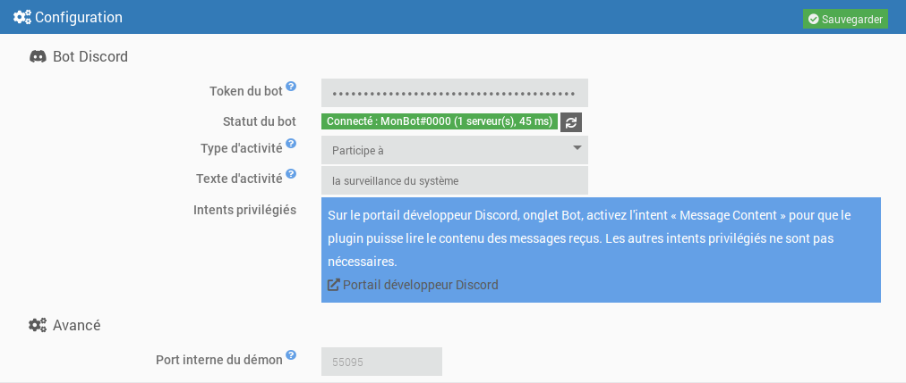
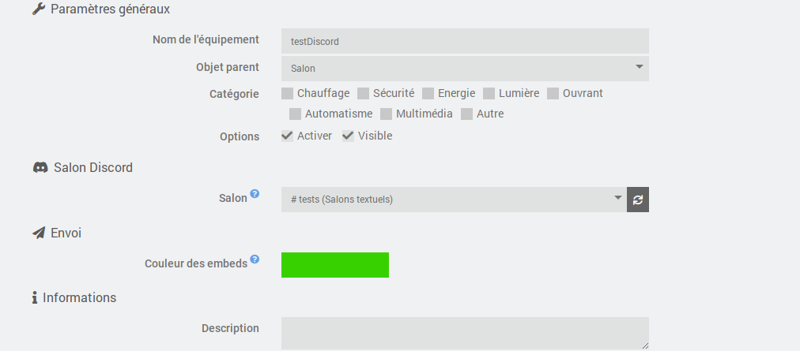
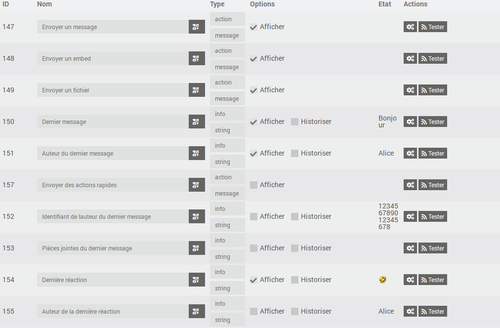
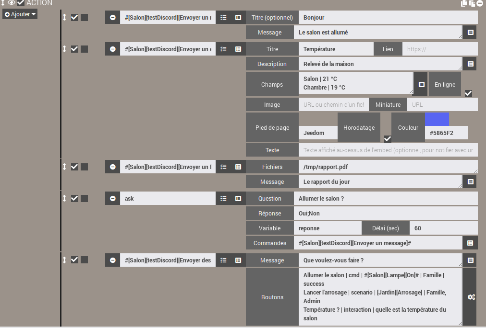
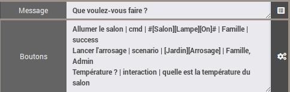

# Plugin JeeDiscord

Le plugin **JeeDiscord** relie Jeedom à un serveur Discord grâce à un bot : envoi de messages depuis les scénarios, réception des messages et des réactions, questions (ask) avec boutons, etc.

Il s'appuie sur la bibliothèque [discord.js](https://discord.js.org/) v14 et sur l'API Discord v10.

> **Important**
>
> Le plugin est en cours de développement. Cette documentation sera complétée au fur et à mesure de l'ajout des fonctionnalités.

# Prérequis

- Jeedom 4.4 minimum
- Debian 12 minimum
- Node.js : installé automatiquement par Jeedom lors de l'installation des dépendances

# Créer le bot Discord

1. Rendez-vous sur le [portail développeur Discord](https://discord.com/developers/applications) et cliquez sur **New Application**.
2. Dans l'onglet **Bot**, cliquez sur **Reset Token** puis copiez le token. Il ne sera plus affiché ensuite : conservez-le en lieu sûr et ne le partagez jamais.
3. Toujours dans l'onglet **Bot**, section **Privileged Gateway Intents**, activez **Message Content Intent**. Les intents **Presence** et **Server Members** ne sont pas nécessaires.
4. Dans l'onglet **OAuth2 > URL Generator**, cochez les scopes `bot` et `applications.commands`, puis les permissions nécessaires (voir ci-dessous). Ouvrez l'URL générée pour inviter le bot sur votre serveur.

Permissions recommandées pour le bot :

| Permission | Utilisation |
|---|---|
| View Channels | Voir les salons surveillés |
| Send Messages | Envoyer des messages |
| Embed Links | Envoyer des messages enrichis (embeds) |
| Attach Files | Envoyer des fichiers et des captures |
| Read Message History | Retrouver les messages pour les modifier ou les supprimer |
| Add Reactions | Réagir aux messages |
| Manage Messages | Supprimer les messages (nettoyage) |
| Manage Channels | Renommer un salon ou modifier son sujet |

# Configuration du plugin

Après l'activation du plugin, installez les dépendances puis renseignez :

- **Token du bot** : le token copié à l'étape 2. Il est chiffré dans la base Jeedom et masqué dans les logs.
- **Type d'activité** et **Texte d'activité** : texte affiché sous le nom du bot dans Discord (par exemple « Personnalisé » + « Surveille la maison »). Laissez le texte vide pour ne rien afficher.
- **Port interne du démon** (avancé) : port local utilisé entre Jeedom et le démon. Ne le modifiez qu'en cas de conflit avec un autre plugin.

Le **statut du bot** indique si le démon est démarré et connecté à Discord, avec le nom du bot, le nombre de serveurs et la latence. La modification de l'activité est appliquée immédiatement, sans redémarrer le démon. La saisie ou la modification du token démarre ou redémarre le démon (si la gestion automatique du démon est activée), et le statut se met à jour tout seul après la sauvegarde.



# Le démon

Le démon est un programme Node.js unique qui maintient la connexion avec Discord. Il est conçu pour rester léger :

- il est lancé avec une priorité basse (`nice`) ;
- il ne demande à Discord que les événements utiles au plugin (serveurs, messages, réactions) ;
- ses caches sont limités (messages récents, membres) et purgés régulièrement.

**Respect des limites de Discord** : les limites de débit de l'API (par route et globale) sont gérées par discord.js, qui met les requêtes en attente au lieu de les perdre. Le plugin ajoute une file par salon, qui conserve l'ordre des actions et fusionne les mises à jour répétitives (par exemple un renommage de salon : seule la dernière valeur est envoyée).

**Connexion** : en cas de coupure réseau au démarrage, le démon retente la connexion avec un délai croissant (de 15 secondes à 5 minutes). Une fois connecté, les reconnexions sont automatiques. Si Discord refuse la connexion (token invalide, intent « Message Content » non activé), le démon s'arrête et n'est plus relancé automatiquement, afin de ne pas épuiser le quota de connexions journalier de Discord. Un message s'affiche dans le centre de messages : corrigez le problème puis sauvegardez la configuration du plugin.

# Logs

Le plugin utilise trois logs :

- `jeediscord` : actions côté Jeedom (démarrage du démon, événements reçus, erreurs) ;
- `jeediscord_daemon` : activité du démon et échanges avec Discord ;
- `jeediscord_packages` : installation des dépendances.

En niveau **Debug**, le log du démon détaille chaque requête envoyée à Discord (méthode, route, code de retour, quota restant), les limites de débit atteintes et les échanges avec Jeedom. Les informations sensibles sont systématiquement masquées (`***`) : token du bot, clé API Jeedom, jetons d'interaction et de webhook. Le token n'apparaît ni dans les logs ni dans la liste des processus du système.

# Configuration des équipements

Un équipement correspond à **un salon Discord**.

- **Salon** : liste des salons visibles par le bot, groupés par serveur. Elle est disponible quand le démon est connecté à Discord et se met à jour automatiquement quand un salon est créé, renommé ou supprimé. Le bouton d'actualisation force la mise à jour. La mention « droits insuffisants » signale un salon où le bot ne peut pas envoyer de messages.
- **Couleur des embeds** : couleur de la bordure des messages enrichis envoyés dans ce salon, utilisée quand le scénario n'en précise pas.



# Commandes

Chaque équipement dispose des commandes suivantes, utilisables dans les scénarios :

| Commande | Type | Rôle |
|---|---|---|
| Envoyer un message | action / message | Envoie un texte. Le titre, s'il est renseigné, est affiché en gras sur la première ligne. |
| Envoyer un embed | action / message | Envoie un message enrichi (titre, lien, description, champs, image, couleur, pied de page, horodatage). |
| Envoyer un fichier | action / message | Envoie un ou plusieurs fichiers, avec un texte optionnel. |
| Envoyer des actions rapides | action / message | Envoie un message sous lequel se trouvent des boutons qui lancent une commande, un scénario ou une interaction Jeedom. |
| Dernier message | info / autre | Contenu du dernier message reçu dans le salon. |
| Auteur du dernier message | info / autre | Nom affiché de son auteur (surnom sur le serveur, sinon nom d'affichage). |
| Identifiant de l'auteur du dernier message | info / autre | Identifiant Discord de l'auteur, fiable pour les conditions de scénario (un nom peut changer). |
| Pièces jointes du dernier message | info / autre | Adresses des pièces jointes, une par ligne. |
| Dernière réaction | info / autre | Emoji de la dernière réaction ajoutée ou retirée. |
| Auteur de la dernière réaction | info / autre | Nom affiché de la personne qui a réagi. |
| Dernière réaction ajoutée | info / binaire | 1 si la réaction a été ajoutée, 0 si elle a été retirée. |



Les commandes d'envoi sont utilisées dans les **actions des scénarios** : choisissez la commande dans la liste, le formulaire correspondant s'affiche. Les commandes « Envoyer un embed », « Envoyer un fichier » et « Envoyer des actions rapides » sont masquées du dashboard, ce qui n'empêche pas de les utiliser dans les scénarios.



## Envoyer un message

Les textes de plus de 2000 caractères (limite de Discord) sont découpés automatiquement en plusieurs messages, de préférence aux retours à la ligne.

Cette commande accepte aussi les fichiers transmis par Jeedom : rapports générés par l'action **Rapport** d'un scénario, captures envoyées par d'autres plugins, etc.

## Envoyer un embed

Dans un scénario, la commande affiche un formulaire dédié :

- **Titre** et **Lien** : le lien rend le titre cliquable ;
- **Description** : texte principal (4096 caractères maximum) ;
- **Champs** : un champ par ligne, sous la forme `Nom | Valeur` (25 champs maximum). Cochez **En ligne** pour les afficher côte à côte ;
- **Image** : adresse web d'une image, ou chemin d'un fichier image sur Jeedom, qui est alors joint au message. **Miniature** : adresse web d'une petite image affichée en haut à droite ;
- **Pied de page**, **Horodatage** (date et heure d'envoi) et **Couleur** (sinon, la couleur de l'équipement) ;
- **Texte** : texte affiché au-dessus de l'embed. Les mentions placées dans un embed ne déclenchent pas de notification : placez-les ici pour prévenir quelqu'un.

Les textes trop longs sont raccourcis pour respecter les limites de Discord (6000 caractères au total par embed).

## Envoyer un fichier

Indiquez le chemin complet d'un fichier par ligne. Discord accepte 10 fichiers par message : au-delà, plusieurs messages sont envoyés. La taille maximale d'un fichier dépend du niveau de boost du serveur (10 Mo sans boost, 50 Mo au niveau 2, 100 Mo au niveau 3). Les fichiers trop volumineux sont ignorés et signalés dans le log.

Par sécurité, les fichiers de configuration de Jeedom (`core/config`), les dossiers système (`/etc`, `/root`...) et les fichiers ou dossiers cachés ne peuvent pas être envoyés.

## Poser une question (action « Demander » des scénarios)

Les commandes « Envoyer un message », « Envoyer un embed » et « Envoyer un fichier » peuvent être choisies dans l'action **Demander** d'un scénario (le champ « Commande » de l'action).

- **Avec des réponses possibles** (par exemple `Oui;Non`) : un bouton par réponse est affiché sous la question. Au-delà de 10 réponses, un menu déroulant les remplace (25 réponses au maximum).
- **Sans réponse imposée** (`*`) : aucun bouton n'est affiché ; la question indique de répondre en écrivant un message, et le prochain message écrit dans le salon est la réponse.

Dès qu'une réponse est donnée, ou à la fin du délai, les boutons sont désactivés et le message indique qui a répondu et quoi (ou « Aucune réponse »). La réponse est enregistrée dans la variable du scénario, comme avec les autres plugins de messagerie. N'importe quelle personne pouvant écrire dans le salon peut répondre.

Une question reste valable tant que le délai n'est pas écoulé et que le démon n'est pas redémarré : après un redémarrage, ses boutons sont simplement désactivés au prochain clic.

## Actions rapides

La commande « Envoyer des actions rapides » envoie un message avec des boutons **qui restent actifs** (même après un redémarrage du démon). Elle s'utilise dans un scénario : ajoutez une action, puis choisissez **[Objet][Équipement][Envoyer des actions rapides]** dans la liste des commandes. Renseignez :

- **Message** : le texte affiché au-dessus des boutons ;
- **Boutons** : un bouton par ligne, au format `Libellé | type | cible | rôles autorisés | couleur`.

| Champ | Contenu |
|---|---|
| Libellé | Texte du bouton. |
| Type | `cmd` (commande action), `scenario` ou `interaction`. |
| Cible | La commande (`#[Objet][Équipement][Commande]#`), le scénario (identifiant, ou nom complet `[Groupe][Objet][Nom]` avec `Aucun` si le scénario n'a pas d'objet, par exemple `[Jardin][Aucun][Arrosage]` ; `[Jardin][Arrosage]` est aussi accepté) ou la phrase de l'interaction. |
| Rôles autorisés | Facultatif : noms ou identifiants de rôles Discord séparés par des virgules. Vide = toute personne du salon. |
| Couleur | Facultatif : `primary` (bleu, par défaut), `secondary`, `success` ou `danger`. |

Exemple :

```
Allumer le salon | cmd | #[Salon][Lampe][On]# | Famille | success
Lancer l'arrosage | scenario | [Jardin][Aucun][Arrosage] | Famille, Admin
Température ? | interaction | quelle est la température du salon
```

Le résultat de l'action est affiché uniquement à la personne qui a cliqué (✅ exécuté, ⛔ rôle non autorisé, ❌ erreur : la cause est alors dans le log `jeediscord`, ⚠️ bouton qui n'est plus valide, par exemple parce que l'équipement a été désactivé ou déplacé dans un autre salon). Pour une interaction, la réponse de l'interaction est affichée. Le bouton ▶ à droite du champ « Boutons » insère un scénario choisi dans la liste, le bouton à côté insère une commande action. Un scénario lancé par un bouton reçoit les tags `#jeediscord_user#` (nom de la personne) et `#jeediscord_channel#` (identifiant du salon). Maximum : 25 boutons par message.



## Mentions

Dans les textes, vous pouvez mentionner :

| Syntaxe | Résultat |
|---|---|
| `@{pseudo}` | un membre, recherché par son nom d'utilisateur, son nom d'affichage ou son surnom sur le serveur |
| `@&{rôle}` | un rôle, recherché par son nom |
| `#{salon}` | un lien vers un salon |

La syntaxe native de Discord (`<@identifiant>`, `<@&identifiant>`) fonctionne aussi. Une mention introuvable reste affichée en texte simple. `@everyone` et `@here` ne notifient personne.

La recherche des membres se fait par nom et ne nécessite pas l'intent privilégié « Server Members ».

## Réception des messages et des réactions

Les commandes info sont mises à jour à chaque message ou réaction reçu dans le salon, y compris quand la valeur ne change pas : un même message ou un même emoji reçu deux fois déclenche deux fois les scénarios. Le contenu du message et l'emoji sont mis à jour en dernier : un scénario déclenché par **Dernier message** lit donc l'auteur et les pièces jointes de ce même message (même principe pour **Dernière réaction**).

Les emojis standards sont transmis tels quels (par exemple 👍), les emojis personnalisés du serveur sous la forme `:nom:`. Exemple de condition de scénario : `#[Maison][Discord][Dernière réaction]# == "👍"`.

Les messages du bot lui-même et les messages système de Discord (épinglage, arrivée d'un membre...) sont ignorés. Les messages des autres bots et des webhooks sont transmis.

Les adresses des pièces jointes sont fournies par Discord et expirent au bout de 24 heures environ : utilisez-les rapidement.

Seuls les événements des salons associés à un équipement actif sont transmis par le démon à Jeedom.

## Fonctionnement de l'envoi

L'envoi est asynchrone : le scénario continue immédiatement, et le message est placé dans la file d'attente du salon. Les messages d'un même salon partent toujours dans l'ordre. Les fichiers sont lus au moment de l'appel : vous pouvez supprimer un fichier temporaire juste après la commande.

Avant d'envoyer, le plugin vérifie les droits du bot dans le salon (voir, envoyer des messages, intégrer des liens, joindre des fichiers). En cas de droit manquant ou d'échec, une erreur est inscrite dans le log `jeediscord`.
